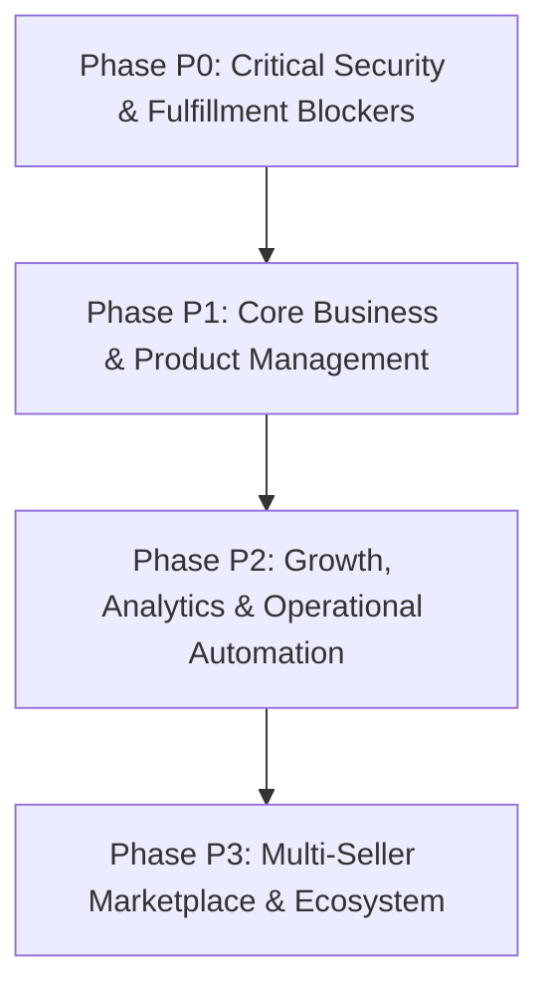

# STUDYVISIONS — ADMIN PANEL DEVELOPMENT ROADMAP
**Document ID:** SV-DOC-AUDIT-005  
**Audit Date:** October 21, 2026  
**Auditor:** Antigravity Engineering Architecture & Security Audit System  
**Repository:** `studyvisions129/studyvisions`  

---

## 1. Roadmap Architecture Overview

The development roadmap is structured into four sequential phases, strictly prioritizing security, financial safety, and fulfillment integrity before adding growth features or marketplace expansion:

---

## 2. Phase P0 — Critical Blockers (Immediate Pre-Launch Requirements)

### Task SV-ROADMAP-P0-001: Payment Security Hardening & Secret Protection
- **Task ID:** `SV-ROADMAP-P0-001`
- **Objective:** Eliminate dangerous fallback secret `"xxx"` in payment verification and webhooks; add strict configuration validation.
- **Complexity:** **Low**
- **Existing Dependencies:** `src/app/api/checkout/verify/route.ts`, `src/app/api/checkout/webhook/route.ts`
- **Files / Modules Affected:**
  - `src/app/api/checkout/verify/route.ts`
  - `src/app/api/checkout/webhook/route.ts`
- **Expected Deliverables:** Strict environment checks throwing 500 error on missing secrets; HMAC signature verification test cases.
- **Acceptance Criteria:**
  - If `RAZORPAY_KEY_SECRET` is unset, verification endpoint immediately returns 500 with descriptive error.
  - No fallback developer strings exist in any payment endpoint.
- **Testing Requirements:** Unit tests for verification with valid, invalid, and missing secrets.
- **Risks:** Unhandled 500 if environment variable is forgotten during deployment.

---

### Task SV-ROADMAP-P0-002: Server Action Authorization Lockdown (`requireAdmin`)
- **Task ID:** `SV-ROADMAP-P0-002`
- **Objective:** Secure all unauthenticated server actions across the admin panel with `await requireAdmin()`.
- **Complexity:** **Low**
- **Existing Dependencies:** `src/lib/auth-utils.ts`
- **Files / Modules Affected:**
  - `src/app/admin/ads/actions.ts`
  - `src/app/admin/sellers/actions.ts`
  - `src/app/admin/free-content/actions.ts`
  - `src/app/admin/promotions/actions.ts`
- **Expected Deliverables:** All mutation actions verify user session and assert role `ADMIN` or `SUPER_ADMIN`.
- **Acceptance Criteria:**
  - Direct execution of actions without admin session throws `Forbidden: Admin access required`.
- **Testing Requirements:** Automated test asserting unauthenticated call rejections.
- **Risks:** None.

---

### Task SV-ROADMAP-P0-003: Multi-Item Order Digital Fulfillment Fix
- **Task ID:** `SV-ROADMAP-P0-003`
- **Objective:** Ensure all products in multi-item orders are unlocked in `Purchase` table.
- **Complexity:** **Medium**
- **Existing Dependencies:** Prisma `Order`, `OrderItem`, `Purchase` models
- **Files / Modules Affected:**
  - `src/app/api/checkout/verify/route.ts`
  - `src/app/api/checkout/webhook/route.ts`
- **Expected Deliverables:** Loop granting access for every `order.items[i].productId`.
- **Acceptance Criteria:**
  - An order with $N$ items creates $N$ corresponding `Purchase` records.
- **Testing Requirements:** E2E test with 2+ order items confirming all items appear in user library.
- **Risks:** Database transaction failures on partial upserts (use `prisma.$transaction`).

---

### Task SV-ROADMAP-P0-004: Student Downloads Fulfillment Engine
- **Task ID:** `SV-ROADMAP-P0-004`
- **Objective:** Replace mockup empty state in `/dashboard/downloads` with real student purchase downloads and secure file URLs.
- **Complexity:** **Medium**
- **Existing Dependencies:** `prisma.purchase`, `prisma.product`
- **Files / Modules Affected:**
  - `src/app/dashboard/downloads/page.tsx`
  - `src/app/api/downloads/[purchaseId]/route.ts` (New secure signed URL endpoint)
- **Expected Deliverables:** Student dashboard downloads grid rendering purchased eBooks, Notes PDFs, and resources with download buttons.
- **Acceptance Criteria:**
  - Paying students can click and download their purchased PDF assets.
  - Non-purchasing users cannot access the download endpoints.
- **Testing Requirements:** Test download authorization with valid and invalid user sessions.
- **Risks:** Asset URL expiration or storage bandwidth limits.

---

## 3. Phase P1 — Core Business Operations (Launch Readiness)

### Task SV-ROADMAP-P1-001: Course & Notes Builders Implementation
- **Task ID:** `SV-ROADMAP-P1-001`
- **Objective:** Replace placeholder stubs (`/admin/courses`, `/admin/notes`) with real hierarchical builders.
- **Complexity:** **High**
- **Existing Dependencies:** Prisma schema (requires `Course`, `CourseSection`, `Lesson`, `NoteBundle` models)
- **Files / Modules Affected:**
  - `prisma/schema.prisma`
  - `src/app/admin/courses/page.tsx`, `actions.ts`
  - `src/app/admin/notes/page.tsx`, `actions.ts`
- **Expected Deliverables:** Full Course builder (sections, video lessons, assignments) and Notes bundle builder with PDF attachments.
- **Acceptance Criteria:**
  - Admin can create a course, add chapters and video links, and publish to the public course catalog.
- **Testing Requirements:** Create, update, re-order, and delete lifecycle tests for course lessons.

---

### Task SV-ROADMAP-P1-002: Business Analytics Integration with Central Financial Engine
- **Task ID:** `SV-ROADMAP-P1-002`
- **Objective:** Migrate `/admin/analytics` and `RevenueTab.tsx` from hardcoded demo figures to `calculateFinancials()`.
- **Complexity:** **Medium**
- **Existing Dependencies:** `src/lib/services/financial-calculations.ts`
- **Files / Modules Affected:**
  - `src/app/admin/analytics/page.tsx`
  - `src/app/admin/analytics/_components/RevenueTab.tsx`
- **Expected Deliverables:** All 9 tabs (Overview, Revenue, Products, Customers, Marketing, Funnel, Profit, Attribution, Reports) display live database metrics without demo warnings.
- **Acceptance Criteria:**
  - Real database orders and expenses immediately reflect across all analytics cards.
- **Testing Requirements:** Assert numbers in `/admin/analytics` match `/admin` Command Center metrics.

---

### Task SV-ROADMAP-P1-003: Admin Navigation Integrity & Quick Add Fix
- **Task ID:** `SV-ROADMAP-P1-003`
- **Objective:** Fix broken Quick Add links, connect Global Search to real database query, and clean up sidebar dead routes.
- **Complexity:** **Medium**
- **Existing Dependencies:** `AdminTopBar.tsx`, `AdminSidebar.tsx`
- **Files / Modules Affected:**
  - `src/app/admin/_components/AdminTopBar.tsx`
  - `src/app/admin/_components/AdminSidebar.tsx`
  - `src/app/api/admin/search/route.ts` (New live search endpoint)
- **Expected Deliverables:** Working global search across Products, Orders, and Customers; all Quick Add buttons point to valid creation modals/pages.
- **Acceptance Criteria:**
  - Zero clicks lead to unexpected `[...placeholder]` screens for core modules.
- **Testing Requirements:** Visual and automated link crawler test.

---

### Task SV-ROADMAP-P1-004: Transactional Email Integration (Resend)
- **Task ID:** `SV-ROADMAP-P1-004`
- **Objective:** Install Resend SDK and send automatic email receipts upon successful payment.
- **Complexity:** **Medium**
- **Existing Dependencies:** `package.json`, Razorpay verify and webhook routes
- **Files / Modules Affected:**
  - `src/lib/email.ts` (New)
  - `src/app/api/checkout/verify/route.ts`
  - `src/app/api/checkout/webhook/route.ts`
- **Expected Deliverables:** Clean HTML receipt email delivered to customer with order details and download link.
- **Acceptance Criteria:**
  - Every `PAID` order triggers an asynchronous email delivery to the customer.
- **Required External Configuration:** `RESEND_API_KEY`, verified sender domain in Resend.

---

## 4. Phase P2 — Growth, Automation & Media Management

### Task SV-ROADMAP-P2-001: Cloudinary Media Library Asset Manager
- **Task ID:** `SV-ROADMAP-P2-001`
- **Objective:** Replace `/admin/media` placeholder with interactive asset upload, browse, and copy-link library.
- **Complexity:** **Medium**
- **Files / Modules Affected:** `src/app/admin/media/page.tsx`, `src/lib/cloudinary.ts`

### Task SV-ROADMAP-P2-002: Abandoned Checkout Recovery Engine
- **Task ID:** `SV-ROADMAP-P2-002`
- **Objective:** Identify orders remaining in `PENDING` status for > 2 hours and trigger recovery reminders.
- **Complexity:** **Medium**
- **Files / Modules Affected:** `src/app/admin/orders/page.tsx`, `src/app/api/cron/`

### Task SV-ROADMAP-P2-003: Operational Automation Center
- **Task ID:** `SV-ROADMAP-P2-003`
- **Objective:** One-click batch actions (bulk publish, bulk tag, export customer CSV, auto-refund approval for failed deliveries).
- **Complexity:** **Medium**
- **Files / Modules Affected:** `src/app/admin/orders/`, `src/app/admin/students/`

---

## 5. Phase P3 — Marketplace & Multi-Seller Architecture

### Task SV-ROADMAP-P3-001: Seller Onboarding & Commission Engine
- **Task ID:** `SV-ROADMAP-P3-001`
- **Objective:** Build seller self-serve registration, commission splits (e.g. 80/20), and product submission approval queue.
- **Complexity:** **High**
- **Files / Modules Affected:** `src/app/admin/sellers/`, `prisma/schema.prisma`

### Task SV-ROADMAP-P3-002: Seller Payouts & Financial Reconciliation
- **Task ID:** `SV-ROADMAP-P3-002`
- **Objective:** Monthly automated seller payout ledger, TDS deduction, and Razorpay Payouts integration.
- **Complexity:** **High**
- **Files / Modules Affected:** `src/app/admin/sellers/payouts/`, `src/lib/services/financial-calculations.ts`
